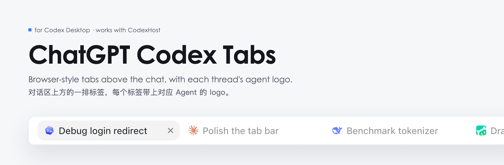
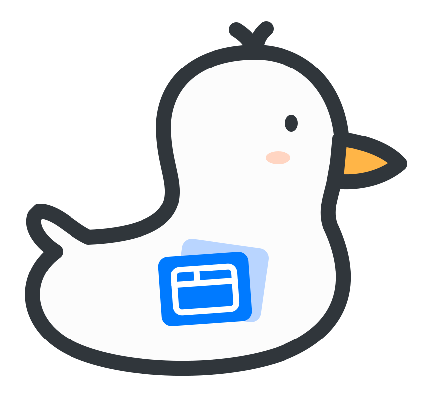
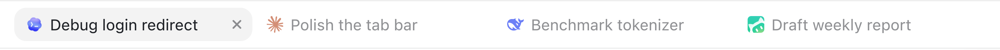
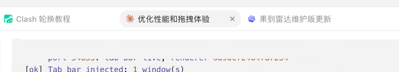
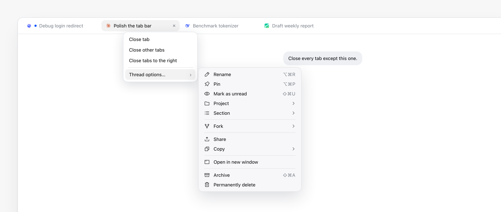

<picture>
  <source media="(prefers-color-scheme: dark)" srcset="assets/banner-dark.png">
  
</picture>

<p>
  
  
  <a href="https://github.com/BytePioneer-AI/codex-host"></a>
  <a href="https://linux.do/"></a>
  <a href="LICENSE"></a>
  <a href="https://www.threads.com/@realtimyry"></a>
</p>

**English** · [简体中文](README.zh-CN.md) · [Setup guide for AI agents](AGENTS.md)

<picture>
  <source media="(prefers-color-scheme: dark)" srcset="assets/brand/logo-dark.svg">
  
</picture>

Codex Desktop keeps every thread in the sidebar. With four or five threads going at once, I kept scrolling that sidebar to get back to the one I had open a minute ago. This adds a tab row above the chat, the way a browser does it, and puts each thread's agent logo (Codex, Claude Code, DeepSeek, WorkBuddy and the rest) on its tab.

Nothing inside the app bundle changes. A small background script adds the tab bar while the app runs, so the official signature stays intact and app updates keep working. You can use it with [CodexHost](https://github.com/BytePioneer-AI/codex-host) or on its own.

<table>
  <tr>
    <td width="33%" valign="top"> <b>3 commands to install</b><br>Copy, paste, done. No packages to install.</td>
    <td width="33%" valign="top"> <b>CodexHost optional</b><br>Works with it or without it.</td>
    <td width="33%" valign="top"> <b>App left untouched</b><br>Nothing in <code>/Applications</code> is modified.</td>
  </tr>
</table>

##  What you get

<table>
  <tr>
    <td width="50%" valign="top"> <b>A tab per thread</b><br>Open a thread in the sidebar and it gets a tab. <kbd>+</kbd> starts a new chat.</td>
    <td width="50%" valign="top"> <b>Keyboard switching</b><br>Click a tab, or press <kbd>⌘1</kbd> to <kbd>⌘8</kbd>. <kbd>⌘9</kbd> jumps to the last tab.</td>
  </tr>
  <tr>
    <td valign="top"> <b>Drag to reorder</b><br>The other tabs slide out of the way; <kbd>Esc</kbd> cancels. The tab drops wherever you let go.</td>
    <td valign="top"> <b>Right-click menu</b><br>Close a tab, the others, or the ones to its right. <kbd>Shift</kbd><kbd>F10</kbd> opens it from the keyboard.</td>
  </tr>
  <tr>
    <td valign="top"> <b>Agent logos</b><br>With CodexHost, each tab shows the agent's logo. Hover for its name.</td>
    <td valign="top"> <b>Running indicator</b><br>A blue dot marks a thread that is still running.</td>
  </tr>
  <tr>
    <td valign="top"> <b>Closing is safe</b><br><kbd>×</kbd> or middle-click closes the tab only. The thread is not deleted or archived.</td>
    <td valign="top"> <b>Remembers your order</b><br>Tab order survives restarts.</td>
  </tr>
  <tr>
    <td valign="top"> <b>Thread options</b><br>Hover <b>Thread options…</b> in the tab menu and the sidebar's own menu opens beside it: rename, pin, archive and the rest.</td>
    <td valign="top"> <b>Speaks your language</b><br>Follows the language Codex is set to. 20 languages built in; anything else falls back to English.</td>
  </tr>
</table>

<picture>
  <source media="(prefers-color-scheme: dark)" srcset="assets/tabs-dark.png">
  
</picture>

Drag a tab and the others slide out of the way. Right-click a tab to close the rest in one go.



Right-click a tab for the tab actions. Hover **Thread options…** and the sidebar's own menu opens next to it, while the tab menu stays open.

<picture>
  <source media="(prefers-color-scheme: dark)" srcset="assets/tab-menu-en-dark.png">
  
</picture>

##  Before you start

| You need | How to check |
|---|---|
| A Mac. Tested on macOS 27.0.1 | |
| `ChatGPT.app` (the Electron build with Codex) in `/Applications`. Tested on 26.1027.51404 and 26.1029.61003. `Codex.app` is matched too but untested | Open Finder → Applications |
| `/usr/bin/python3`, from Apple's Command Line Tools | Run `python3 --version` in Terminal. If macOS offers to install the tools, click Install |
| [CodexHost](https://github.com/BytePioneer-AI/codex-host): optional. Tested on 0.17.0 and 0.17.3 | Only needed for the CodexHost install and for agent logos |

> [!TIP]
> **Never used Terminal?** Press <kbd>⌘</kbd><kbd>Space</kbd>, type `Terminal`, press <kbd>Return</kbd>. Paste each command below and press <kbd>Return</kbd>.

##  Install

###  Download

```bash
git clone https://github.com/yuanruoyu515/chatgpt-codex-tabs.git
cd chatgpt-codex-tabs
```

###  Pick one install

<table>
  <tr>
    <th width="50%"> I use CodexHost</th>
    <th width="50%"> I don't use CodexHost</th>
  </tr>
  <tr>
    <td valign="top">

```bash
python3 install.py
```

Start Codex Desktop through CodexHost, the way its README describes. The tab bar shows up about two seconds after the window loads.

✅ Agent logos on tabs<br>
⚠️ Opening from the Dock needs the [cold-start helper](#opening-from-the-dock-with-codexhost)<br>
💡 Smoother with [codexhost-auto-launch](https://github.com/yuanruoyu515/codexhost-auto-launch), which injects automatically

</td>
    <td valign="top">

```bash
python3 install.py --standalone
```

If the app is open, quit it. Then open it from the Dock as usual. The window shows up, closes, and comes back a few seconds later with the tab bar.

✅ Works from the Dock, Finder and Spotlight<br>
➖ Tabs show titles only, no agent logos

</td>
  </tr>
</table>

Changed your mind? Run `install.py` again, with or without `--standalone`. Both use the same files, so it just switches.

###  Check it

```bash
python3 doctor.py
```

Every line should read `[ok]`. Anything marked `[!!]` tells you what's missing; see [Troubleshooting](#troubleshooting). Once it passes you can delete the downloaded folder. Everything needed was copied to `~/Library/Application Support/chatgpt-tabs-inject/` and starts at login.

> [!TIP]
> **Let your AI agent do it.** [AGENTS.md](AGENTS.md) is written for coding agents: preconditions, exact commands, how to verify, and what not to touch. Paste this into Claude Code, Codex or any agent that can run shell commands:
>
> ```text
> Set up https://github.com/yuanruoyu515/chatgpt-codex-tabs on this Mac. Follow AGENTS.md in that repo and stop to ask me before restarting my desktop app.
> ```

<details>
<summary><b>What the standalone install will and won't restart</b></summary>
<br>

When you open the app without a debug port, the injector quits that fresh launch and opens it again with one. It is careful about which launches it touches:

- It only reopens an app that launched less than 20 seconds ago. An app that has been open longer is left alone, even without the port.
- If a CodexHost launcher is running, the injector leaves the launch to CodexHost and only injects.
- If the reopened app still has no port, the injector stops reopening for 10 minutes rather than looping.

</details>

<a id="opening-from-the-dock-with-codexhost"></a>

<details>
<summary><b>Opening from the Dock with CodexHost</b></summary>
<br>

Stock CodexHost only takes over when you start the app through CodexHost. Open ChatGPT/Codex straight from the Dock, Finder or Spotlight and there is no debug port, so no tab bar. I wrote an opt-in helper that hands those cold starts to CodexHost automatically: [codex-host#702](https://github.com/BytePioneer-AI/codex-host/pull/702). It is not merged yet. Until it is, either start through CodexHost every time, use the standalone install, or install the helper from my branch ([setup guide](https://github.com/yuanruoyu515/codex-host/blob/feat/macos-cold-start-automation/docs/platforms/macos/cold-start-automation.md); needs macOS 13+ and Swift 6 from the Xcode Command Line Tools):

```bash
git clone -b feat/macos-cold-start-automation https://github.com/yuanruoyu515/codex-host.git
cd codex-host
python3 tools/macos-auto-launch/manage.py install
```

On each cold start the app restarts once (the window flashes briefly). That restart is CodexHost taking over.

</details>

<a id="troubleshooting"></a>

##  Troubleshooting

Run `python3 doctor.py` and look at the first `[!!]` line.

| `[!!]` line | What it means | What to do |
|---|---|---|
| `Desktop app` | ChatGPT.app / Codex.app is not in `/Applications` | Install the Codex desktop app first |
| `CodexHost` | You picked the CodexHost install but CodexHost isn't there | Install CodexHost, or switch: `python3 install.py --standalone` |
| `Injector LaunchAgent` | The background script isn't running | Run `python3 install.py` again (add `--standalone` if that's your install) |
| `App started with a debug port` | The app is closed, or was opened without the port | CodexHost: quit and start it through CodexHost. Standalone: quit and open it again |
| `Tab bar injected` | The port is there but the bar isn't yet | Wait 5 seconds and run `doctor.py` again. Still failing? The app may have changed; [open an issue](https://github.com/yuanruoyu515/chatgpt-codex-tabs/issues) with the `inject.log` lines `doctor.py` prints |

##  Uninstall

```bash
python3 uninstall.py
rm -rf ~/Library/Application\ Support/chatgpt-tabs-inject
```

A tab bar that is already on screen goes away on the next reload or app restart.

##  Limits

- Local Codex threads only. Remote hosts, cloud tasks and plain ChatGPT chats do not get tabs yet.
- **Thread options…** needs the thread's row in the sidebar. If the thread sits in a collapsed project, the tab menu can only close tabs.
- Only the main window has a tab bar. Windows opened with "Open in new window" do not.
- Without CodexHost there are no sidebar agent icons, so tabs show titles only.
- In standalone mode, every cold start costs one extra app launch, a few seconds.
- It depends on the app's DOM attributes. If an update renames `data-app-action-sidebar-thread-*` or the `open-in-main-window` message, the bar stops appearing until the selectors are updated. `doctor.py` will still show the injector running.

> [!WARNING]
> The debug port only listens on `127.0.0.1`, but any program running on your Mac can connect to it and run code inside the app. That holds in both modes; CodexHost opens the same port.

##  How it works

<details>
<summary><b>The technical part</b></summary>
<br>

1. The app runs with `--remote-debugging-port` bound to `127.0.0.1`. CodexHost passes the flag when it starts the app. In standalone mode, `inject.py` watches for an app process younger than 20 seconds that lacks it, quits that process, and reopens the app with `open -a … --args --remote-debugging-port=<free port>`.
2. `src/inject.py` runs as a LaunchAgent. It watches `ps` for the app process with that flag, reads `http://127.0.0.1:<port>/json` and finds the main window (`app://-/index.html`).
3. It sends `src/renderer.js` over the DevTools protocol with `Runtime.evaluate`. The script is versioned by its own hash, so a reload or a changed `renderer.js` gets re-injected within a few seconds and an unchanged one is left alone.
4. `renderer.js` reads the sidebar rows (`data-app-action-sidebar-thread-*`) to build tabs. With CodexHost, it copies the agent logo from CodexHost's `data-codexhost-sidebar-agent-icon` span and caches it per agent in `localStorage`, so a tab keeps its logo while its sidebar row is collapsed or scrolled away.
5. Switching tabs clicks the sidebar row, or falls back to the app's own `open-in-main-window` message. Right-clicking a tab opens the tab bar's own menu. Hovering its **Thread options…** item sends a right-click to that row, so the app opens its own menu. That menu is native, so the tab actions can't be added to it. It opens on hover rather than on click because macOS puts a native menu under the pointer when it opens right after a click, whatever position the app asks for.

I tried patching first: copy the app, edit `app.asar`, re-sign it ad hoc. macOS refused to launch it (spawn error 163 from restricted entitlements, then library validation failing on mixed Team IDs), and every official update would have meant doing it all again. Runtime injection skips all of that, and I'd pick it again.

| Path | What it is |
|---|---|
| `src/renderer.js` | The tab bar. Runs inside the app's main window |
| `src/inject.py` | The injector. A minimal DevTools client, standard library only |
| `install.py` / `uninstall.py` | Register or remove the LaunchAgent |
| `doctor.py` | Read-only health check |
| `AGENTS.md` | Setup instructions for AI agents |

</details>

## Credits

- Tab design follows [Horizontal Tabs](https://github.com/b-nnett/codexplusplus-horizontal-tabs). The code here is a separate implementation.
- Agent logos come from [CodexHost](https://github.com/BytePioneer-AI/codex-host) at runtime. None are shipped in this repo.
- Section icons: [Phosphor Icons](https://phosphoricons.com) (MIT).

Made by Ruoyu. Find me on Threads: [@realtimyry](https://www.threads.com/@realtimyry).

[MIT License](LICENSE)
