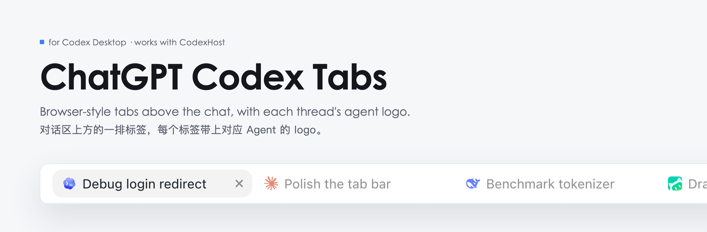
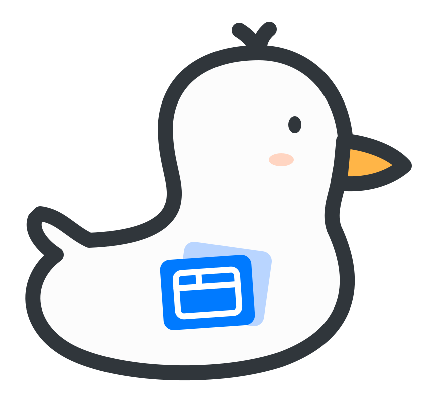
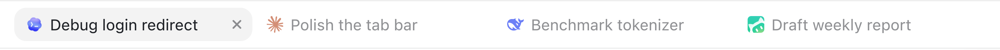
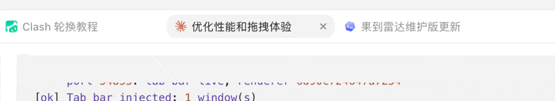
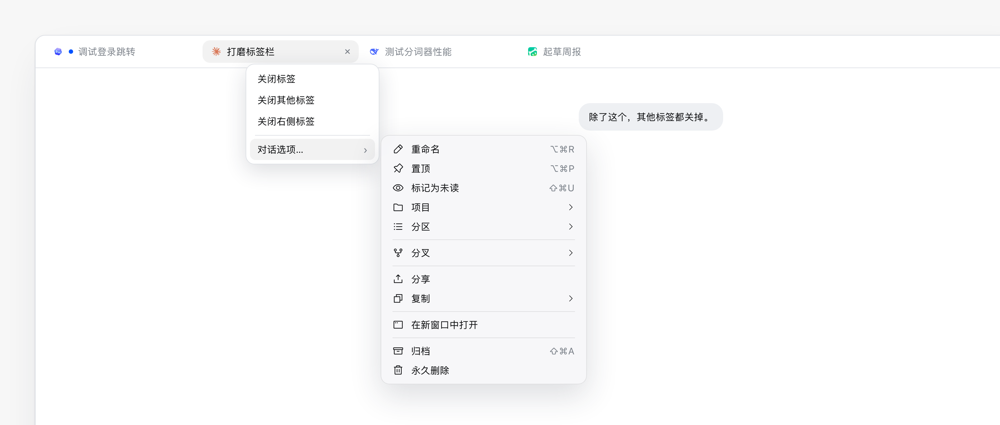

<picture>
  <source media="(prefers-color-scheme: dark)" srcset="assets/banner-dark.png">
  
</picture>

<p>
  
  
  <a href="https://github.com/BytePioneer-AI/codex-host"></a>
  <a href="LICENSE"></a>
  <a href="https://www.threads.com/@realtimyry"></a>
</p>

[English](README.md) · **简体中文** · [给 AI Agent 的配置说明](AGENTS.md)

<picture>
  <source media="(prefers-color-scheme: dark)" srcset="assets/brand/logo-dark.svg">
  
</picture>

Codex 桌面版的对话都放在左侧侧栏。同时开四五个对话的时候，我总在侧栏里来回翻，找刚才那个。于是做了这个：在对话区上方加一排标签，用法跟浏览器差不多，每个标签前面还有这个对话所用 Agent 的 logo（Codex、Claude Code、DeepSeek、WorkBuddy 等）。

App 包里的东西一点没改。一个后台小脚本在 App 运行时把标签栏加进去，官方签名保持原样，App 更新后照常能用。配合 [CodexHost](https://github.com/BytePioneer-AI/codex-host) 用可以，单独用也可以。

<table>
  <tr>
    <td width="33%" valign="top"> <b>三行命令装好</b><br>复制、粘贴就行，不用装任何包。</td>
    <td width="33%" valign="top"> <b>CodexHost 可选</b><br>有没有它都能用。</td>
    <td width="33%" valign="top"> <b>不动 App 本体</b><br><code>/Applications</code> 里什么都不改。</td>
  </tr>
</table>

##  功能

<table>
  <tr>
    <td width="50%" valign="top"> <b>一个对话一个标签</b><br>在侧栏点开一个对话，上方就多一个标签。点 <kbd>+</kbd> 新建对话。</td>
    <td width="50%" valign="top"> <b>键盘切换</b><br>点标签，或按 <kbd>⌘1</kbd> 到 <kbd>⌘8</kbd>；<kbd>⌘9</kbd> 跳到最后一个。</td>
  </tr>
  <tr>
    <td valign="top"> <b>拖动排序</b><br>其他标签会让开位置，按 <kbd>Esc</kbd> 取消。在哪里松手，标签就落在哪里。</td>
    <td valign="top"> <b>右键菜单</b><br>关闭这个标签、其他标签或右侧标签。键盘上按 <kbd>Shift</kbd><kbd>F10</kbd> 也能打开。</td>
  </tr>
  <tr>
    <td valign="top"> <b>Agent logo</b><br>装了 CodexHost 时，标签上显示 Agent 的 logo，鼠标悬停能看到名字。</td>
    <td valign="top"> <b>运行提示</b><br>还在运行的对话，标签上有个蓝点。</td>
  </tr>
  <tr>
    <td valign="top"> <b>放心关</b><br>点 <kbd>×</kbd> 或鼠标中键只关标签，对话不会被删除或归档。</td>
    <td valign="top"> <b>记得顺序</b><br>重启后标签顺序还在。</td>
  </tr>
  <tr>
    <td valign="top"> <b>对话选项</b><br>鼠标移到标签菜单里的「对话选项…」上，旁边会弹出侧栏原本的菜单：重命名、置顶、归档等。</td>
    <td valign="top"> <b>跟着你的语言</b><br>跟着 Codex 设置的语言走。内置 20 种，其他语言显示英语。</td>
  </tr>
</table>

<picture>
  <source media="(prefers-color-scheme: dark)" srcset="assets/tabs-dark.png">
  
</picture>

拖动标签时，其他标签会让开；右键标签还能一次关掉其他标签：



右键标签是标签操作。鼠标移到「对话选项…」上，旁边会弹出侧栏原本的菜单，标签菜单也还开着：

<picture>
  <source media="(prefers-color-scheme: dark)" srcset="assets/tab-menu-zh-dark.png">
  
</picture>

##  开始之前

| 需要 | 怎么确认 |
|---|---|
| 一台 Mac，在 macOS 27.0.1 上测过 | |
| `/Applications` 里的 `ChatGPT.app`（带 Codex 的 Electron 版），测试版本 26.1027.51404 和 26.1029.61003。`Codex.app` 也能匹配，但没测过 | 打开访达 → 应用程序 |
| `/usr/bin/python3`，来自苹果的 Command Line Tools | 在终端运行 `python3 --version`。系统提示安装开发者工具的话，点「安装」 |
| [CodexHost](https://github.com/BytePioneer-AI/codex-host)：可选，测试版本 0.17.0 和 0.17.3 | 只有 CodexHost 安装方式和 Agent logo 需要它 |

> [!TIP]
> **没用过终端？** 按 <kbd>⌘</kbd><kbd>空格</kbd>，输入「终端」或 `Terminal`，回车。把下面的命令一段段粘贴进去，按回车。

##  安装

###  下载

```bash
git clone https://github.com/yuanruoyu515/chatgpt-codex-tabs.git
cd chatgpt-codex-tabs
```

###  二选一安装

<table>
  <tr>
    <th width="50%"> 我在用 CodexHost</th>
    <th width="50%"> 我没装 CodexHost</th>
  </tr>
  <tr>
    <td valign="top">

```bash
python3 install.py
```

按 CodexHost README 里的方法启动 Codex 桌面版。窗口加载完大约两秒，标签栏就出来了。

✅ 标签上有 Agent logo<br>
⚠️ 从 Dock 打开要装[冷启动小工具](#opening-from-the-dock-with-codexhost)<br>
💡 配合 [codexhost-auto-launch](https://github.com/yuanruoyu515/codexhost-auto-launch) 自动注入，体验更好

</td>
    <td valign="top">

```bash
python3 install.py --standalone
```

App 开着的话先退出，再照常从 Dock 打开。窗口会先出来、关掉，几秒后带着标签栏回来。

✅ 从 Dock、访达、聚焦搜索打开都行<br>
➖ 标签只显示标题，没有 Agent logo

</td>
  </tr>
</table>

想换一种？重新运行 `install.py`，带不带 `--standalone` 就决定切到哪一种。两种用的是同一套文件，直接切换。

###  检查

```bash
python3 doctor.py
```

每行都应该是 `[ok]`。哪行是 `[!!]`，就说明缺了什么，看下面的[排查](#troubleshooting)。检查通过后，下载的文件夹可以删掉：需要的文件已经复制到 `~/Library/Application Support/chatgpt-tabs-inject/`，登录后自动运行。

> [!TIP]
> **让 AI Agent 帮你装。** [AGENTS.md](AGENTS.md) 是写给编程 Agent 看的：前提条件、具体命令、怎么验证、哪些东西不能碰。把下面这段贴给 Claude Code、Codex 或其他能跑 shell 命令的 Agent：
>
> ```text
> Set up https://github.com/yuanruoyu515/chatgpt-codex-tabs on this Mac. Follow AGENTS.md in that repo and stop to ask me before restarting my desktop app.
> ```

<details>
<summary><b>独立安装会重开哪些 App、不会动哪些</b></summary>
<br>

App 打开时没带调试端口，注入器就把刚启动的它退出，再带着端口重新打开。它对要动哪个 App 很小心：

- 只重开启动不到 20 秒的 App。已经开了一阵的，就算没有端口也不动。
- 有 CodexHost 启动器在运行时，启动交给 CodexHost，注入器只管注入。
- 重开后还是没有端口，就停 10 分钟不再重开，不会来回循环。

</details>

<a id="opening-from-the-dock-with-codexhost"></a>

<details>
<summary><b>配合 CodexHost 时从 Dock 打开</b></summary>
<br>

原版 CodexHost 只有在你经它启动 App 时才会接管。直接从 Dock、访达或聚焦搜索打开 ChatGPT/Codex，就没有调试端口，也就没有标签栏。我另外写了一个可选的小工具，App 冷启动时自动交给 CodexHost 接管，已经提了 PR：[codex-host#702](https://github.com/BytePioneer-AI/codex-host/pull/702)，还没合并。合并之前有三个办法：每次都经 CodexHost 启动；改用独立安装；或者从我的分支装这个工具（[安装说明](https://github.com/yuanruoyu515/codex-host/blob/feat/macos-cold-start-automation/docs/platforms/macos/cold-start-automation.md)，需要 macOS 13 以上和 Xcode Command Line Tools 里的 Swift 6）：

```bash
git clone -b feat/macos-cold-start-automation https://github.com/yuanruoyu515/codex-host.git
cd codex-host
python3 tools/macos-auto-launch/manage.py install
```

每次冷启动，App 会重开一次，窗口闪一下，这是 CodexHost 在接管。

</details>

<a id="troubleshooting"></a>

##  排查

运行 `python3 doctor.py`，看第一行 `[!!]`。

| `[!!]` 那行 | 意思 | 怎么办 |
|---|---|---|
| `Desktop app` | `/Applications` 里没有 ChatGPT.app / Codex.app | 先装 Codex 桌面版 |
| `CodexHost` | 选了 CodexHost 安装方式，但没装 CodexHost | 装上 CodexHost，或者切换：`python3 install.py --standalone` |
| `Injector LaunchAgent` | 后台脚本没在运行 | 重新运行 `python3 install.py`（独立安装记得加 `--standalone`） |
| `App started with a debug port` | App 没开，或者打开时没带端口 | CodexHost：退出后经 CodexHost 启动。独立安装：退出再打开 |
| `Tab bar injected` | 端口有了，标签栏还没出来 | 等 5 秒再运行一次 `doctor.py`。还不行的话可能是 App 改版了，[开个 issue](https://github.com/yuanruoyu515/chatgpt-codex-tabs/issues)，附上 `doctor.py` 打印的 `inject.log` 内容 |

##  卸载

```bash
python3 uninstall.py
rm -rf ~/Library/Application\ Support/chatgpt-tabs-inject
```

已经显示的标签栏，要等页面刷新或重启 App 才会消失。

##  限制

- 只支持本地 Codex 对话。远程主机、云任务和普通 ChatGPT 对话暂时没有标签。
- 「对话选项…」要靠侧栏里对应的那一行。对话在折叠起来的项目里时，标签菜单只能关标签。
- 只有主窗口有标签栏，「在新窗口中打开」开出来的窗口没有。
- 没有 CodexHost 就没有侧栏 Agent 图标，标签只显示标题。
- 独立模式下，每次冷启动都要多启动一次 App，多花几秒。
- 依赖 App 的 DOM 属性。哪天更新把 `data-app-action-sidebar-thread-*` 或 `open-in-main-window` 改名了，标签栏就不会出现，要等选择器跟着改。这时 `doctor.py` 仍会显示注入器在运行。

> [!WARNING]
> 调试端口只监听 `127.0.0.1`，但你 Mac 上跑的任何程序都能连上去，在 App 里执行代码。两种模式都一样，CodexHost 开的也是这个端口。

##  原理

<details>
<summary><b>技术细节</b></summary>
<br>

1. App 运行时带着 `--remote-debugging-port`，只监听 `127.0.0.1`。CodexHost 启动 App 时会加上这个参数；独立模式下，`inject.py` 盯着启动不到 20 秒、又没带参数的 App 进程，把它退出，再用 `open -a … --args --remote-debugging-port=<空闲端口>` 重新打开。
2. `src/inject.py` 作为 LaunchAgent 常驻，从 `ps` 里找带这个参数的 App 进程，读 `http://127.0.0.1:<端口>/json`，找到主窗口（`app://-/index.html`）。
3. 它用 DevTools 协议的 `Runtime.evaluate` 把 `src/renderer.js` 送进去。脚本按自身内容的哈希算版本：页面刷新了，或者 `renderer.js` 改了，几秒内会重新注入；没变就不动。
4. `renderer.js` 读侧栏每一行的 `data-app-action-sidebar-thread-*` 属性来生成标签。装了 CodexHost 时，再从它的 `data-codexhost-sidebar-agent-icon` 复制 Agent logo，按 Agent 缓存到 `localStorage`。侧栏折叠或滚走了，标签上的 logo 也还在。
5. 切换标签时点侧栏对应那一行；找不到那一行，就发 App 自己的 `open-in-main-window` 消息。右键标签弹出的是标签栏自己的菜单；鼠标移到里面的「对话选项…」上，才把右键转给侧栏那一行，由 App 弹出它自己的菜单。App 那个菜单是系统原生菜单，加不进标签操作。之所以悬停打开而不是点击打开，是因为刚点过鼠标就弹出的原生菜单，macOS 会把它放在光标底下，不管 App 指定的位置。

我一开始走的是改包的路：复制一份 App，改 `app.asar`，再 ad-hoc 重签名。macOS 直接拒绝启动（先是受限 entitlement 导致 spawn error 163，后来 Team ID 不一致，库校验又过不去），而且每次官方更新都得从头再来一遍。运行时注入没有这些麻烦，再选一次我还是选它。

| 路径 | 是什么 |
|---|---|
| `src/renderer.js` | 标签栏本体，在 App 主窗口里运行 |
| `src/inject.py` | 注入器，一个最小的 DevTools 客户端，只用标准库 |
| `install.py` / `uninstall.py` | 注册、移除 LaunchAgent |
| `doctor.py` | 只读的自检脚本 |
| `AGENTS.md` | 给 AI Agent 的配置说明 |

</details>

## 致谢

- 标签的设计参考 [Horizontal Tabs](https://github.com/b-nnett/codexplusplus-horizontal-tabs)，代码是另写的。
- Agent logo 在运行时取自 [CodexHost](https://github.com/BytePioneer-AI/codex-host)，本仓库不附带任何 logo 文件。
- 章节小图标来自 [Phosphor Icons](https://phosphoricons.com)（MIT）。

作者 Ruoyu，Threads：[@realtimyry](https://www.threads.com/@realtimyry)。

[MIT 许可](LICENSE)
